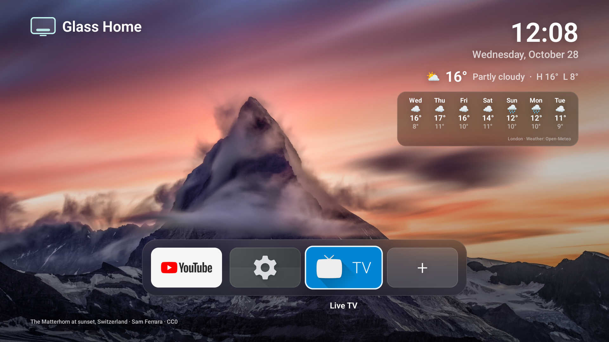
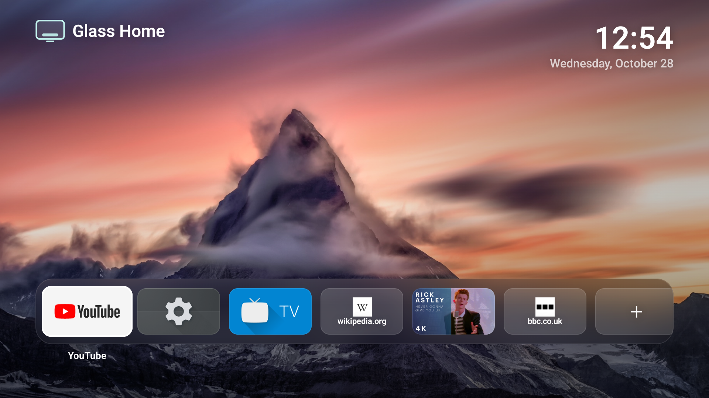
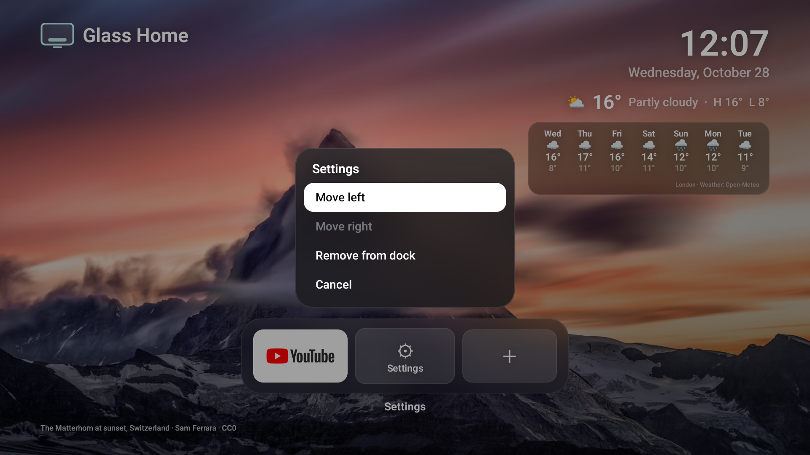
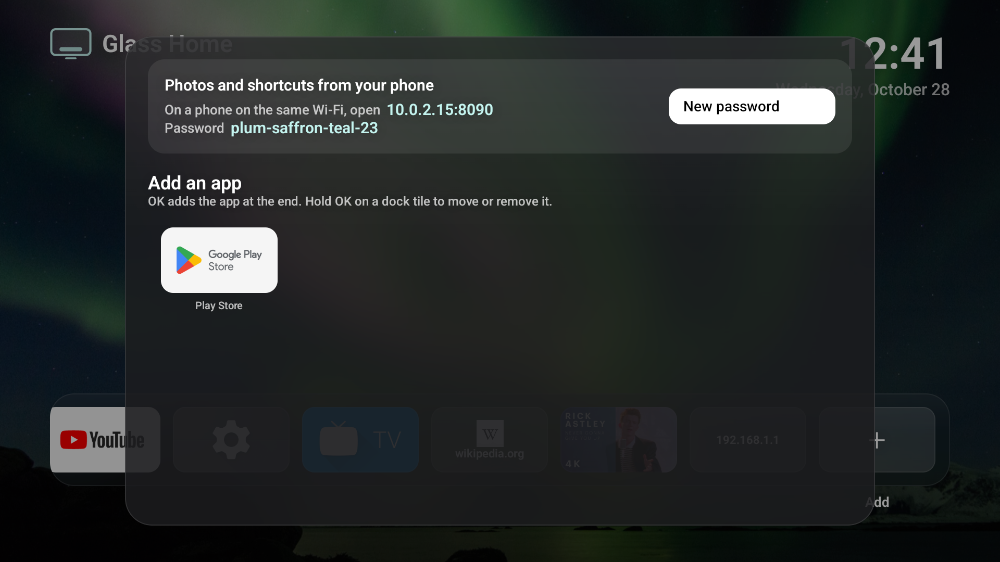

# Glass Home for Android TV

A minimal, Apple TV-style home screen for the Chromecast with Google TV (and
other Android TV devices). It's a port of
[Glass Home for Samsung TVs](https://github.com/victaphu/glass-home-samsung-tv) (MIT).

- Full-screen photos that crossfade every 45 seconds with a slow drift: the
  same 12 CC0 nature photos mixed with your own, shuffled once a day.
- A frosted-glass dock of your apps (each app's own TV banner), then your
  website and YouTube shortcuts, then **+**.
- Clock and date, and optionally the weather (now plus 7 days, from
  [Open-Meteo](https://open-meteo.com/), no account or key).
- A screensaver (only the photos after 3 minutes idle; the first button press
  just wakes the screen) and dimmed photos in the evening.
- **+** shows the address and password of the TV's photo website. Open it on
  your phone to upload photos (resized on the phone, so iPhone HEIC works) and
  add YouTube or website shortcuts.
- Unlike on Samsung, it **can replace the Home button** (see below).

## Install

You need a computer on the same Wi-Fi as the Chromecast, with a JDK 17 and the
Android SDK (`brew install openjdk@17 && brew install --cask android-commandlinetools`).

1. On the Chromecast: **Settings > System > About**, press OK on **Android TV
   OS build** seven times. Then **Settings > System > Developer options**, turn
   on **USB debugging** or **Wireless debugging**. Note the IP address (and, for
   Wireless debugging, the port it shows).
2. For the weather, copy `glasshome.properties.example` to
   `glasshome.properties` and set your place (it stays out of git). Other
   options are in [`Config.kt`](app/src/main/java/com/glasshome/tv/Config.kt).
3. `scripts/install.sh <tv-ip>[:port]` builds and installs it. Accept the
   "Allow debugging?" prompt on the TV the first time.
4. `scripts/install.sh <tv-ip>[:port] --home` makes the Home button open Glass Home.

If `adb connect` says "No route to host" on macOS although the TV answers a
ping, macOS is blocking adb's local network access: run `adb kill-server` and
try again (and allow Local Network access if macOS asks).

### About replacing Home on Google TV

Google TV ignores the "default home app" setting and always opens its own home
screen. `--home` gets around that by disabling Google's launcher
(`com.google.android.apps.tv.launcherx`) and its setup app (`setupwraith`) with
`adb shell pm disable-user`. Nothing is uninstalled.

- **Undo it** with `scripts/install.sh <tv-ip> --restore`.
- **What you lose** while it's off: everything on Google TV's own home screen
  (the recommendations rows, the "For you" tab, the profile switcher). Apps
  and settings keep working; Settings is a tile in the dock. Tested on the
  Google TV emulator (Android 14), not yet on a real Chromecast.
- **A Google TV system update can turn Google's launcher back on.** Run
  `--home` again if Home starts opening Google TV again.

## Using it

| Remote | What happens |
|---|---|
| Left / Right | move along the dock |
| OK | open the app, website or video |
| Hold OK | Move left, Move right, Remove (from the dock, or the shortcut), Cancel |
| OK on **+** | the website address and password; New password; add an app to the dock |
| Back | closes the menu or the panel; does nothing on the home screen |
| Home | back to Glass Home, first tile selected |

## Photos and shortcuts from your phone

On a phone on the same Wi-Fi, open the address shown under **+** and sign in
with the password shown there. It's the same website as the Samsung version:
upload photos (up to 300, 500 MB in total; portrait photos are fitted on
blurred edges or cropped) and add websites or YouTube links (videos,
playlists, Shorts, links with a start time). New photos appear next on the TV.
The phone stays signed in for 30 days; **New password** under **+** signs every
phone out.

- **YouTube shortcuts** open the YouTube app at the video (and start time).
- **Websites** need a web browser, and Google TV doesn't come with one. Install
  one from Google Play; until then the TV says so when you open a website.
- **The website is plain HTTP** on your home network, as on Samsung. It only
  answers devices on your local network and needs the password, but anyone on
  the same Wi-Fi who intercepts traffic could see the password and photos.
- **It runs inside the app**, so it's up while Glass Home is your home screen.
  If Android closes the app to free memory during a long film, the website
  comes back as soon as you press Home.
- Icons and video thumbnails are fetched once, when a shortcut is added, from
  the site itself (no favicon services), and only from public internet
  addresses: a shortcut can never make the TV reach into your home network.

## Settings

Weather location and units in `glasshome.properties` (see above). The rest in
[`Config.kt`](app/src/main/java/com/glasshome/tv/Config.kt): photo timing,
screensaver delay, evening dimming hours, and the apps in the dock on first
start. After the first start the dock is
edited on the TV, and its order is kept on the device.

## How it works

One Kotlin app, using Jetpack Compose, plus OkHttp for fetching shortcut icons.

- `Photos.kt` decodes each photo at screen size, plus a small, box-blurred
  copy. The frosted glass is that blurred copy drawn inside each glass panel's
  shape, using the same zoom and drift as the photo behind it. That's much
  cheaper than a live blur on the Chromecast's GPU.
- `Apps.kt` lists apps with a TV launcher entry (the same set Google TV shows)
  and keeps the dock order.
- `Home.kt` is the screen; `MainActivity.kt` handles the Home button, wakes
  the screensaver, and launches apps.
- The photo animation runs only while the home screen is in front, so it
  doesn't use the GPU behind Netflix.
- `web/` is the phone website, a port of the Samsung version's Node service:
  a small HTTP server (`Http.kt`) on port 8090, the same API and protections
  (`PhotoService.kt`: password sign-in with PBKDF2 and lockouts, session
  cookies, CSRF and Host checks, upload limits), and the same phone page
  (`assets/web/index.html`, unchanged). Photos and shortcuts are stored in the
  app's private storage, so uninstalling removes them.

Photo credits are in [CREDITS.md](CREDITS.md).
